# System Architecture Diagrams

This document contains visual representations of the multi-agent system architecture using Mermaid diagrams.

## System Overview Diagram

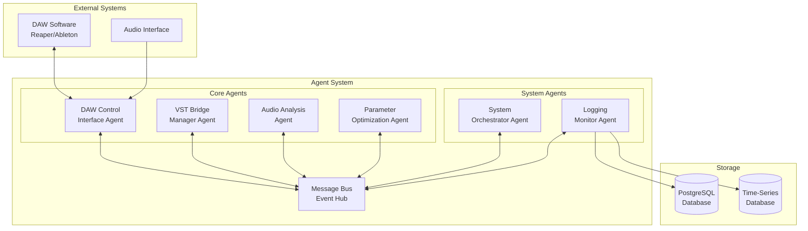

## Data Flow Diagram

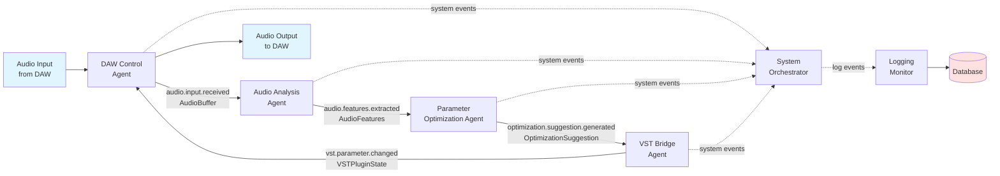

## Message Bus Architecture

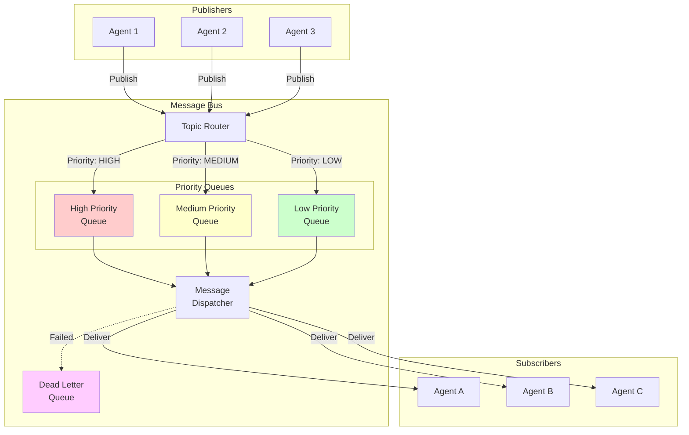

## Agent Communication Matrix

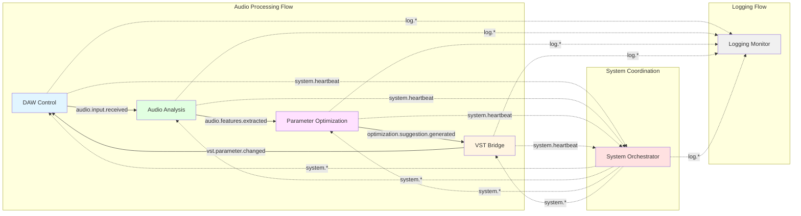

## Agent Lifecycle State Machine

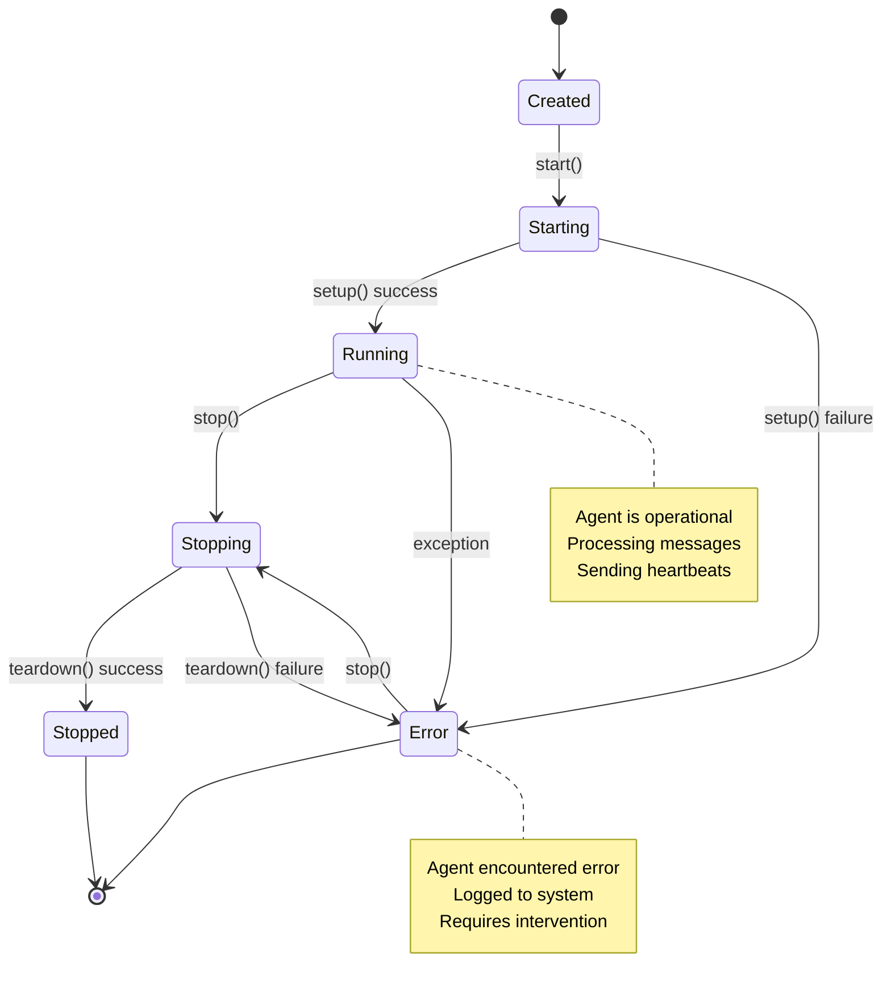

## Request-Response Flow

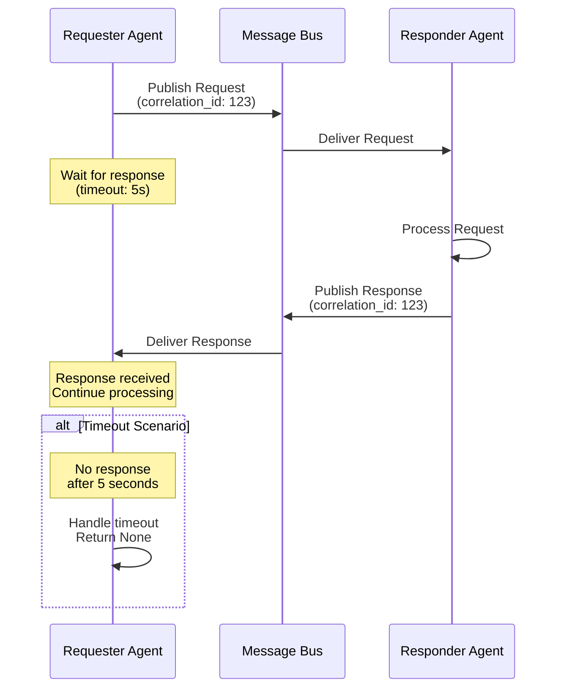

## Audio Processing Pipeline

```mermaid
flowchart TB
    subgraph "Step 1: Audio Capture"
        A1[DAW sends audio buffer]
        A2[DAW Control Agent receives]
        A3[Convert to AudioBuffer format]
        A4[Publish: audio.input.received]

        A1 --> A2 --> A3 --> A4
    end

    subgraph "Step 2: Feature Extraction"
        B1[Audio Analysis receives buffer]
        B2[FFT & Spectral Analysis]
        B3[Temporal Feature Extraction]
        B4[Dynamic Range Analysis]
        B5[Create AudioFeatures object]
        B6[Publish: audio.features.extracted]

        B1 --> B2 --> B3 --> B4 --> B5 --> B6
    end

    subgraph "Step 3: Parameter Optimization"
        C1[Param Optimization receives features]
        C2[Load ML model]
        C3[Generate parameter suggestions]
        C4[Calculate confidence scores]
        C5[Create OptimizationSuggestion]
        C6[Publish: optimization.suggestion.generated]

        C1 --> C2 --> C3 --> C4 --> C5 --> C6
    end

    subgraph "Step 4: VST Parameter Application"
        D1[VST Bridge receives suggestion]
        D2[Validate parameter ranges]
        D3[Apply to VST plugin]
        D4[Capture new VSTPluginState]
        D5[Publish: vst.parameter.changed]

        D1 --> D2 --> D3 --> D4 --> D5
    end

    subgraph "Step 5: DAW Update"
        E1[DAW Control receives state]
        E2[Update DAW project]
        E3[Confirm changes]

        E1 --> E2 --> E3
    end

    A4 --> B1
    B6 --> C1
    C6 --> D1
    D5 --> E1

    style A4 fill:#e1f5ff
    style B6 fill:#e1ffe1
    style C6 fill:#ffe1ff
    style D5 fill:#fff5e1
    style E3 fill:#ffe1e1
```

## Database Schema Diagram

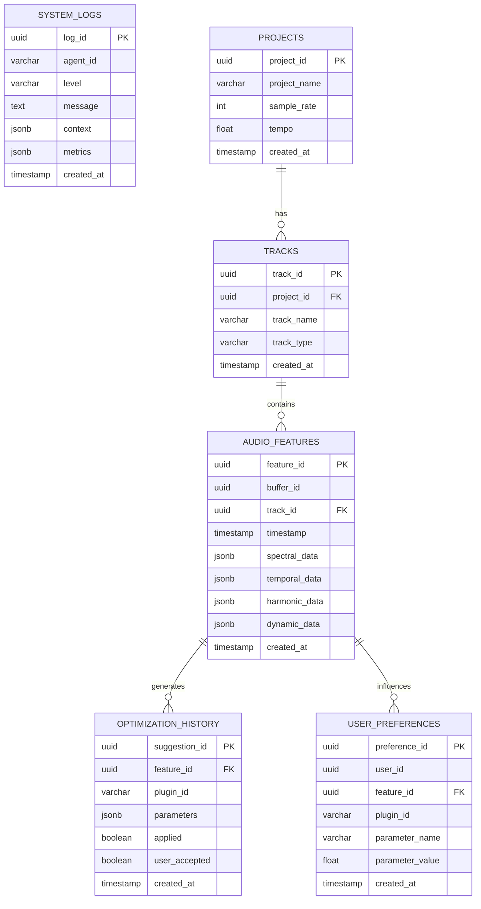

## Deployment Architecture

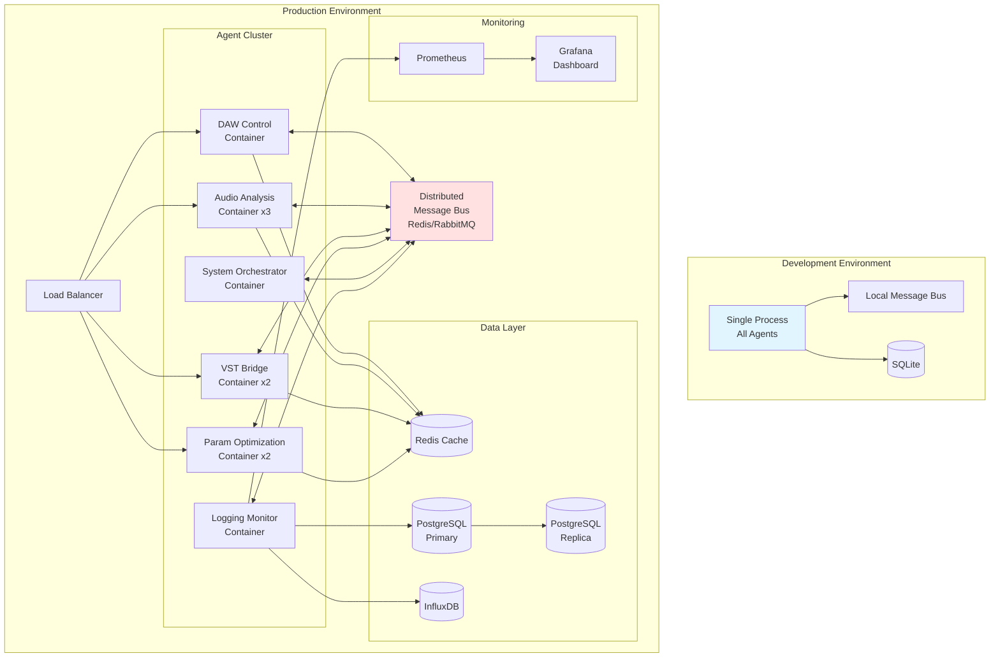

## Error Handling Flow

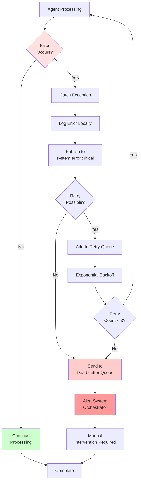

## Monitoring Dashboard Layout

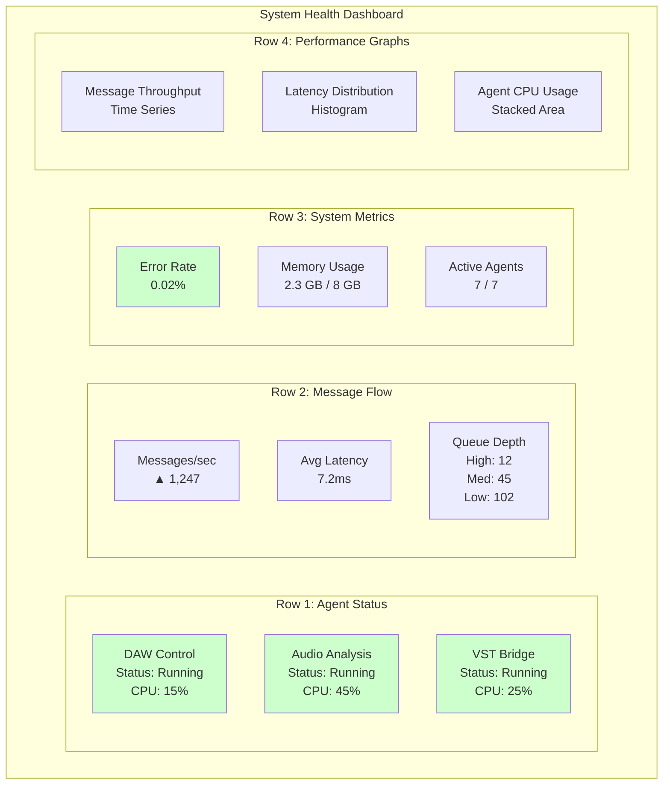
